# Home assistant configuration
[](https://github.com/KaoruKanon/homeassistant-config) [](https://GitHub.com/Naereen/StrapDown.js/graphs/commit-activity) [](https://twitter.com/kaorussh)   [](https://github.com/KaoruKanon/homeassistant-config)

Ma configuration Home Assistant et son front-end, **Kaoru Home** : un panneau sur mesure pensé pour la tablette murale (Lenovo M10+ sous [Fully Kiosk](https://play.google.com/store/apps/details?id=de.ozerov.fully&hl=fr&gl=US), raccordée avec un chargeur magnétique), l'application Companion et le PC.

Historique du front-end :

| Période | Front-end | Ce qu'il a apporté |
|---|---|---|
| Jusqu'en 2025 | [config de matt8707](https://github.com/matt8707/hass-config) | dashboard inspiré de HomeKit (projet arrêté par son auteur) |
| 2025 | [Adaptive Mushroom](https://github.com/sga-noud/adaptive-mushroom) | meilleur responsive, dashboards par personne, menu de navigation |
| Octobre 2026 | Kaoru Home V1 | panneau réécrit de zéro (Lit + TypeScript), sans carte HACS : l'accueil Mushroom refait, plus rapide et plus cohérent |
| Octobre 2026 | Kaoru Home V2 | tuiles « bento », scènes illustrées par pièce, plan de l'appartement en 2D / 3D |
| Depuis novembre 2026 | **Kaoru Home V3** | nouveau design validé sur maquettes, Lit natif sans composant Home Assistant, pages Climat, Bourse et Famille, thèmes sombres |

T'aimes mon repo ? Laisse une ⭐.
* [](https://twitter.com/kaorussh)
* [Profil HACF](https://forum.hacf.fr/u/kaoru)
* [Topic de mon dashboard sur HACF](https://forum.hacf.fr/t/mon-dashboard-kaoru/1022)

## Kaoru Home

Un panneau Home Assistant écrit en Lit + TypeScript, compilé avec Vite. Les pièces viennent des zones de Home Assistant ; `app/src/config.ts` ajoute seulement ce que le registre ne sait pas : noms, ordre des pièces, favoris par personne, confirmations, plan de l'appartement.

Le panneau **Maison** (`/maison`), déclaré en `panel_custom` dans `configuration.yaml`, est le tableau de bord par défaut (réglé dans Paramètres › Tableaux de bord). Les anciennes versions restent déclarées pendant la transition (`/maison-v2`, `/maison-v1`).

Il n'y a plus de dashboard Lovelace en YAML ni de carte HACS : Lovelace reste disponible en mode stockage (« Aperçu » de Home Assistant).

### Maison V3

Une réécriture du design, page par page, d'après des maquettes validées avant d'écrire le code. Même organisation et mêmes fonctions que la V2, en Lit natif, sans aucun composant `ha-*` de Home Assistant. Mode kiosque pour la tablette : `/maison?kiosk` (cache la barre latérale et l'en-tête de Home Assistant, le menu reste accessible par le bouton « Menu » du rail), `?kiosk=0` pour en sortir. Après 5 minutes sur une autre page, la tablette revient à l'accueil.

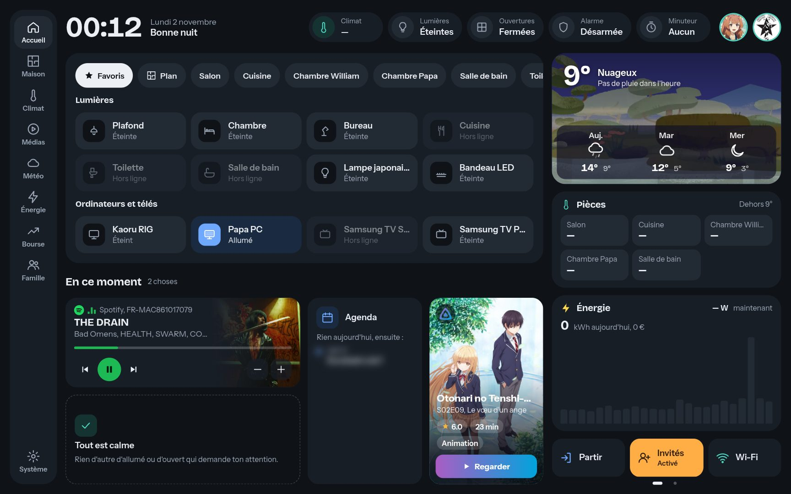

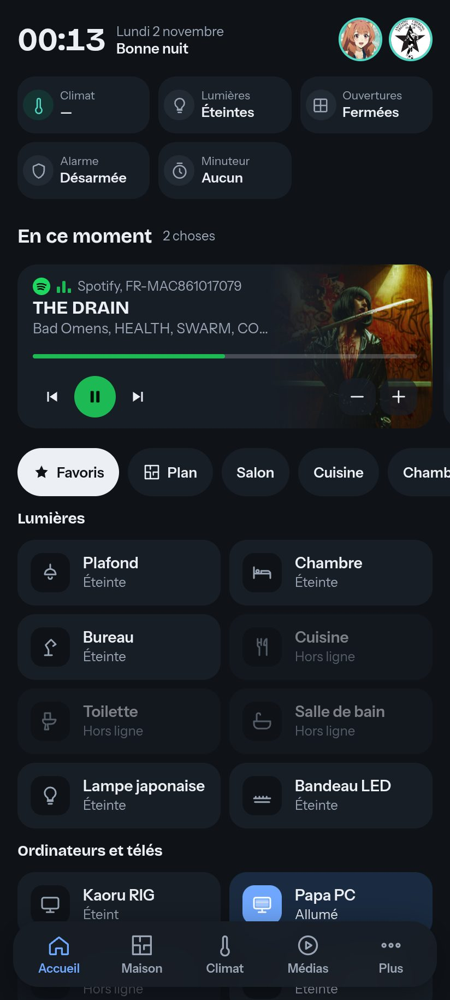 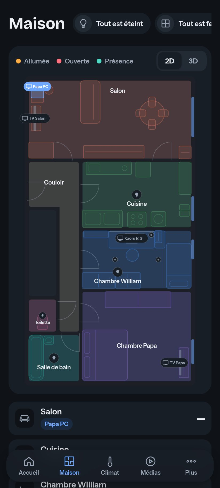 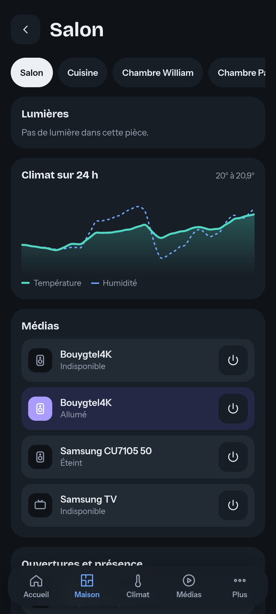 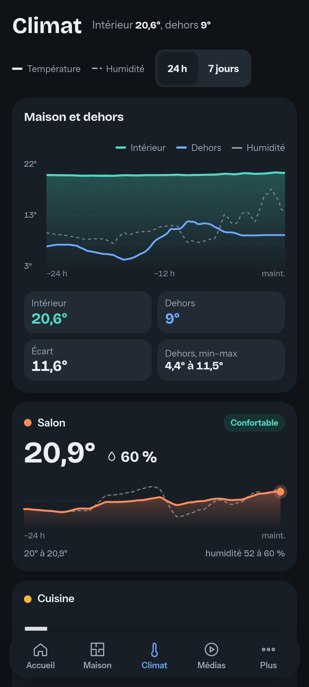 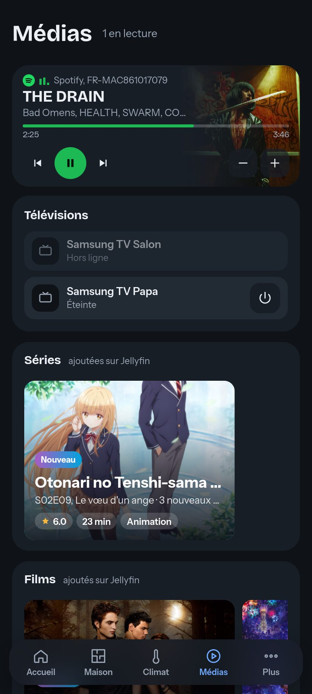 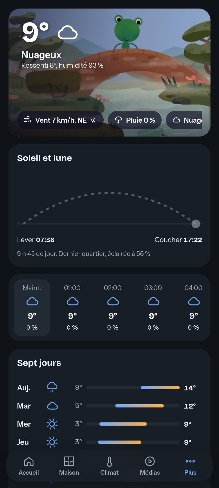 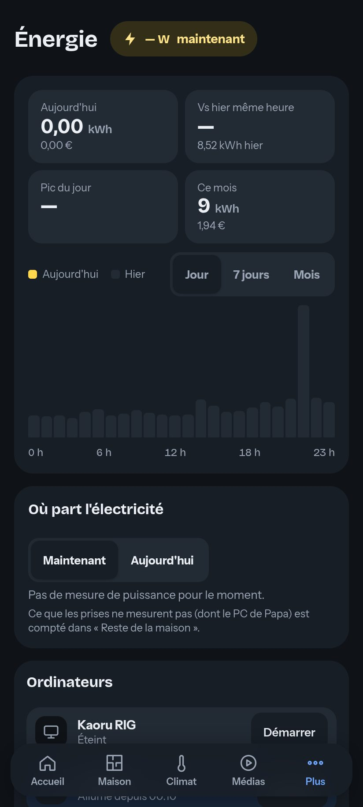 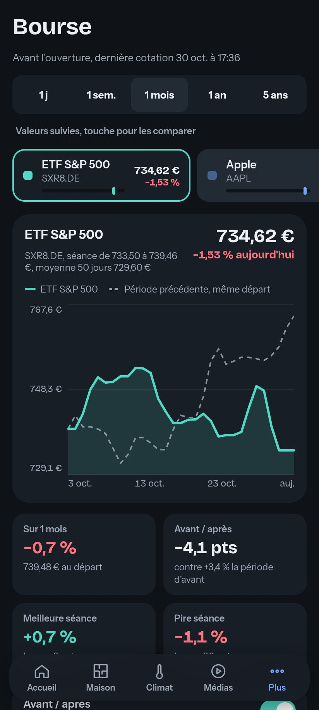 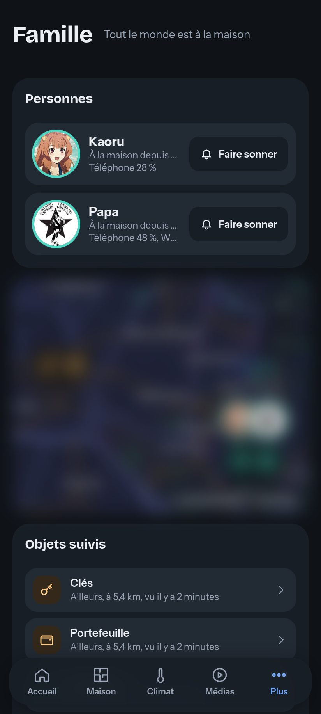 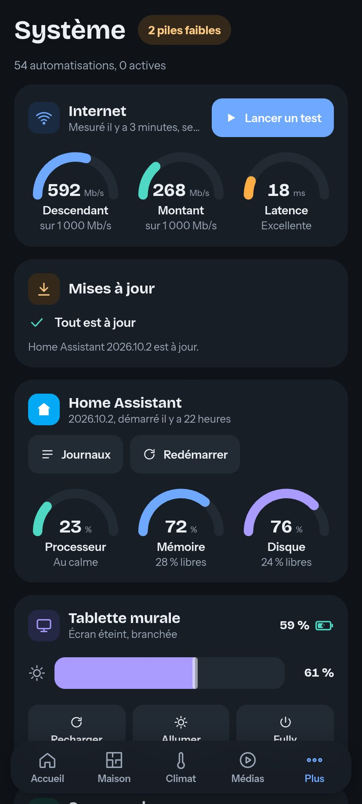

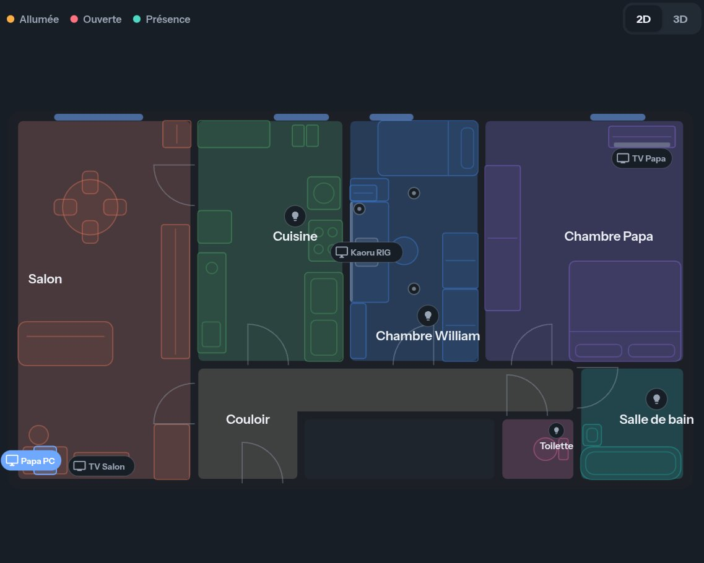 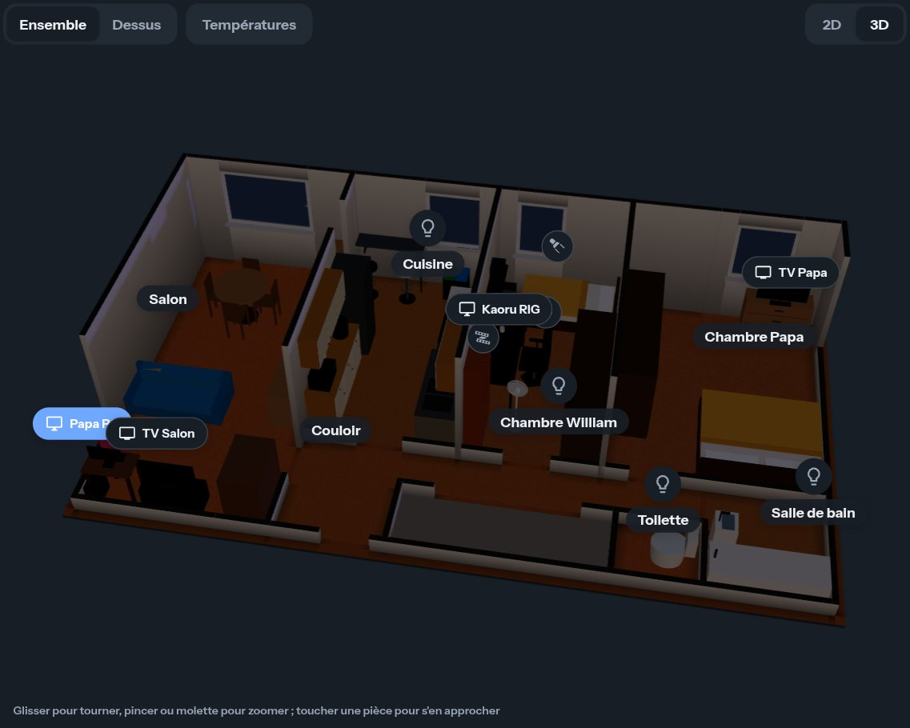

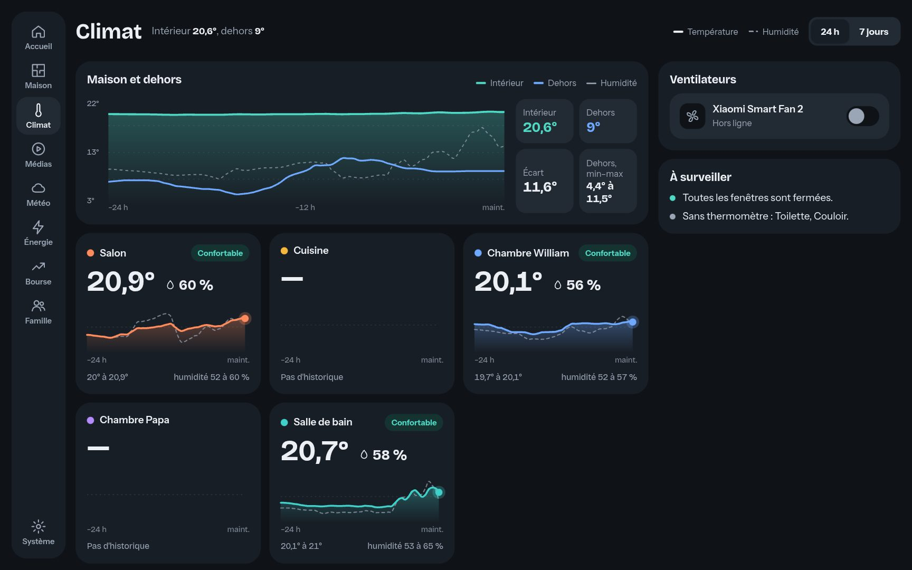 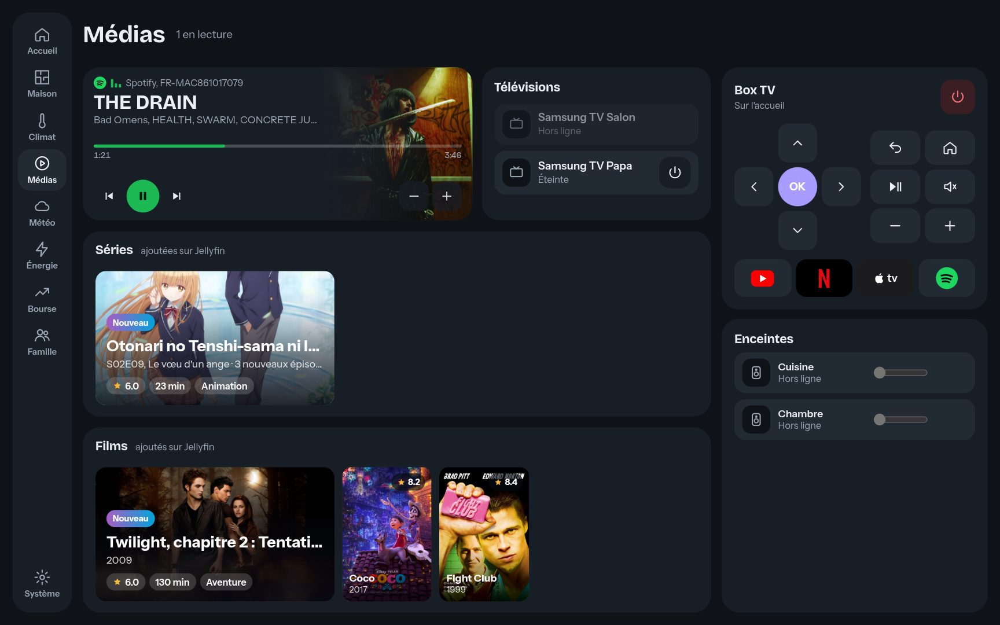
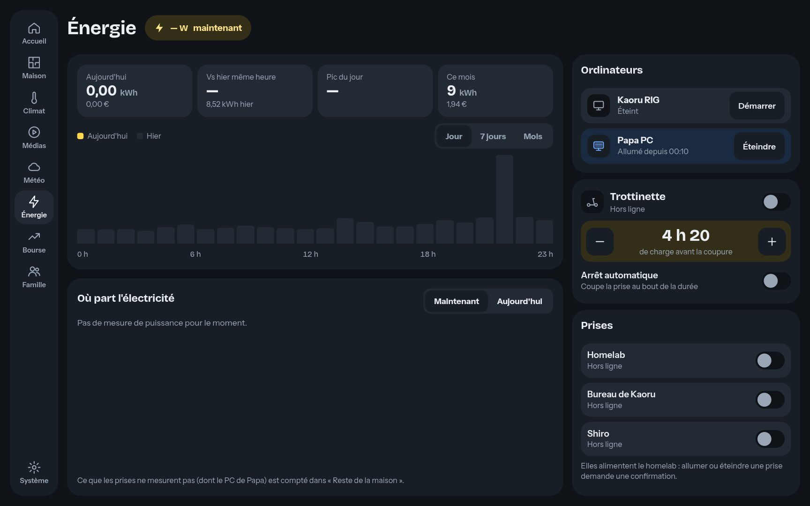 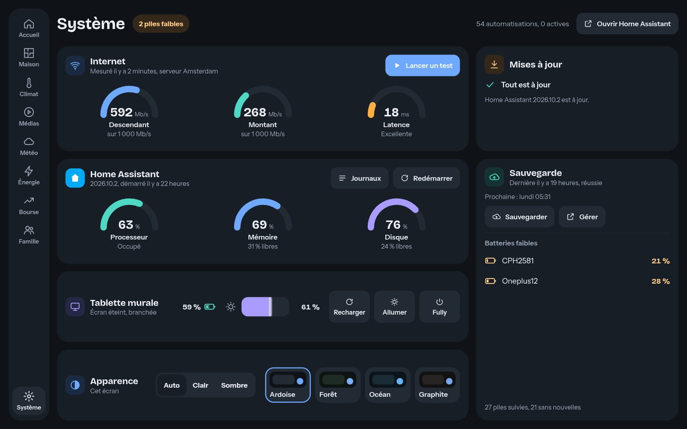

La carte des positions et l'agenda sont floutés sur les captures.

* **Un cadre stable, une zone vivante** : en haut l'heure, les personnes et les badges ; à droite la météo ([grenouille météo de Google](https://github.com/Senexis/Google-Weather-Frog) et trois jours), la température des pièces, l'énergie et les raccourcis. Au milieu, les appareils (lumières favorites, PC, TV, filtrés par pièce) et **« En ce moment »** : ce qui se passe, rangé par priorité dans une grille fixe de 4 × 2 cases, page par page au swipe (musique, fenêtre ouverte, ventilateur, trottinette en charge, TV allumée, agenda, dernier ajout Jellyfin).
* **Navigation** : un rail de neuf entrées sur la tablette et le PC (Accueil, Maison, Climat, Médias, Météo, Énergie, Bourse, Famille, Système), quatre onglets et « Plus » sur le téléphone.
* **Maison** : le plan en 2D (une couleur par pièce) ou en 3D, et la liste des pièces ; une pièce montre ses lumières (toute la carte allume, curseur et couleurs), ses médias, ses ouvertures et son climat.
* **Climat** : la maison et le dehors sur un même graphe, une courbe par pièce avec température et humidité, les ventilateurs.
* **Médias** : la lecture en cours (pochette fondue dans la carte), les TV, les séries et films ajoutés sur Jellyfin, la télécommande de la box avec les logos des applis, les enceintes.
* **Bourse** : une ou plusieurs valeurs, de 1 jour à 5 ans, la période précédente en pointillés, et ce qu'il faut retenir (meilleure et pire séance, écart, corrélation).
* **Famille** : les personnes et les objets suivis sur une carte MapLibre au style VersaTiles, comme celle de Home Assistant 2026.10, téléchargée seulement en ouvrant la page.
* **Système** : Internet, Home Assistant (processeur, mémoire, disque), mises à jour, sauvegarde, tablette, batteries faibles, et le choix du thème.
* **Design** : thème clair et quatre thèmes sombres (Ardoise, Forêt, Océan, Graphite), choisis par écran ; icônes animées quand l'appareil est actif (écran qui scintille, ventilateur qui tourne, enceinte qui émet, prise qui charge), arrêtées si le système demande moins d'animations. Les popups (personnes, ouvertures, alarme, Wi-Fi, PC, lumières) suivent le même design.
* **Tailles d'écran** : tout l'accueil tient sur la tablette 1280 × 800 sans défilement ; sur le téléphone (jusqu'à 354 px de large), une colonne avec des cartes à faire défiler.

### Sécurité des actions

* Les prises Tuya (`switch.smart_plug_*`) et tout ce qui est rattaché à leur appareil demandent une confirmation, dans les deux sens, et ne sont jamais groupées dans un « tout éteindre ».
* Un PC démarre sur un simple appui ; l'éteindre demande une confirmation. Un appui long ou un double appui ouvre ses détails.
* Chaque commande envoie un `turn_on` / `turn_off` explicite selon l'état vu à l'écran, jamais un `toggle`.

### Performances

Mesurées le 1er novembre 2026 sur l'instance de dev, dans les mêmes conditions pour les deux versions. Chargement à froid de l'accueil, profil tablette (1280 × 800), processeur ralenti 4 fois, médiane de 5 mesures (`app/dev/perf.mjs`) :

| | Maison V2 | Maison V3 |
|---|---|---|
| Premier vrai contenu affiché | 3,30 s | 3,00 s |
| Temps de blocage | 1,48 s | 1,09 s |
| JavaScript téléchargé | 1 671 Ko | 1 583 Ko |
| Dont modules ajoutés (`/local`, images comprises) | 440 Ko | 418 Ko |
| Éléments dans la page | 1 131 | 830 |

Lighthouse 12, médiane de 3 :

| Accueil | Maison V2 | Maison V3 |
|---|---|---|
| Performance, mobile | 71 | 73 |
| Performance, ordinateur | 93 | 97 |
| Temps de blocage, mobile | 1,5 s | 0,9 s |
| Accessibilité | 84 | 98 |

Chaque page de la V3 :

| Page | Mobile | Ordinateur | Décalage de mise en page |
|---|---|---|---|
| Accueil | 73 | 97 | 0 |
| Maison (plan) | 79 | 99 | 0 |
| Une pièce | 79 | 98 | 0,007 |
| Climat | 77 | 97 | 0,014 |
| Médias | 76 | 99 | 0,006 |
| Météo | 64 | 98 | 0,004 |
| Énergie | 77 | 98 | 0,011 |
| Bourse | 79 | 99 | 0,01 |
| Famille | 66 | 74 | 0,001 |
| Système | 79 | 100 | 0,007 |

* Famille porte la carte MapLibre, dessinée sans GPU par Chrome sans écran pendant la mesure 
* La V3 ne télécharge rien de la V1 ni de la V2 : ses pages, les popups, la carte (MapLibre) et la 3D (three.js) sont des chunks séparés, chargés à la demande.

### Développer

Sources : `app/` (Node 22). Le bundle (`www/kaoru-home/`) n'est pas versionné : la CI le compile à chaque release et l'inclut dans le zip.

```sh
cd app && npm ci
npm run check   # types
npm test        # tests unitaires (node:test)
npm run build   # www/kaoru-home/ : kaoru-home.js (chargeur), manifest.json, app-<hash>.js, chunks/
```

* `kaoru-home.js` ne change jamais : il lit `manifest.json` (non mis en cache) et charge la version compilée du moment, donc une mise à jour se voit sans vider le cache du navigateur.
* `app/dev/` : tests dans Chrome avec un faux Home Assistant (`harness.mjs` : prises protégées, actions de pièce, PC), audit de mise en page sur dix tailles d'écran (`layout-audit.mjs`), captures (`screens.mjs`), mesures de chargement (`perf.mjs`). Les tests n'actionnent que des entités simulées.
* Le plan : `app/assets/plan/appartement.drawio` est la source ; les murs, fenêtres et meubles en sont extraits dans `app/src/v2/plan-data.ts`, les modèles 3D sont dans `plan3d-models.ts`.

### Publier

Chaque tag publie une release GitHub : l'action *Create Config Zip* compile le panneau et joint `homeassistant-config-<tag>.zip`, qui contient la configuration et le panneau compilé, prêt à être décompressé dans le dossier de configuration de Home Assistant. Il faut Home Assistant 2026.10 ou plus récent (carte native utilisée par le panneau).

## Equipement

| Icon | Device | Total |
|------|:--------------:|:------:|
| 🖥️ |️ Ordinateurs | 2 |
| 🌡️ | Xiaomi mijia Temperature Humidity 2019 | 5 |
| 📱 | Smartphone | 2 |
| 📱 | Lenovo TAB M10+ & Fully Kiosk Browser | 1 |
| 💡 | Bulb E27 yeelight & yeelight strip | 7 |
| 🔘 | Switch Xiaomi | 3 |
| 📺 | Samsung TV | 2 |
| 📦 | Box TV Bouygues | 1 |
| ⚡ | Lixee Zlinky TIC | 1 |
| 🔌 | Tuya Smart Plug Zigbee 3.0 (avec mesure de consommation) | 4 |
| 🗝️ | Sonoff Zigbee 3.0 USB Dongle Plus | 1 |
| 👁️ | Zigbee PIR Module TS0202 | 3 |
| ☀️ | Zigbee Tyua PIR Luminance TS0601 | 1 |
| 🔛 | Zigbee E1 Wall Switch QBKG38LM | 1 |
| 🚪 | Zigbee Déctereur Ouverture Porte et Fenêtre eWeLink SNZB-04 | 6 |
| 🌀 | Ventilateur Xiaomi Mi Smart Pedestal Fan | 1 |

## Fonctionnalités

* Météo : [Météo-France](https://www.home-assistant.io/integrations/meteo_france/) et [OpenWeatherMap](https://www.home-assistant.io/integrations/openweathermap/), radar Windy, grenouille météo
* Consommation électrique : Linky via le module TIC [Lixee ZLinky](https://www.gotronic.fr/art-module-zlinky-tic-avec-antenne-38788.htm) (zigbee), prises qui mesurent, Sankey de répartition
* Température et humidité de chaque pièce
* Suivi des personnes et des objets (traceurs), « trouver mon téléphone »
* Alarme : état, armement par mode, clavier pour le code
* Lumières par pièce, variateur, couleurs, automatisations associées
* Spotify, Google Home, TV Samsung et box TV (télécommande)
* Jellyfin : derniers ajouts, films et séries
* Ordinateurs : allumage, veille, redémarrage, statistiques, capture d'écran ([HASS.Agent](https://github.com/LAB02-Research/HASS.Agent))
* Prises connectées (protégées) et minuterie de la trottinette
* Ventilateur connecté
* Bourse ([Yahoo Finance](https://github.com/iprak/yahoofinance))
* Batteries des appareils, mises à jour, sauvegardes, automatisations
* Dashboard par personne, QR code du Wi-Fi pour les invités, agenda

### Captures d'écran des PC

Source : https://hassagent.readthedocs.io/en/latest/examples/#command-grab-screenshot-using-powershell

* Script PowerShell (voir le dossier du repo, à adapter)
* Bouton « screenshot » dans HASS.Agent qui exécute le script
* Automatisation qui appuie sur ce bouton via MQTT
* Entité caméra qui lit le fichier

### Minuteur du Google Home de la cuisine

Le minuteur en cours s'affiche dans les badges de l'accueil et clignote tant qu'il tourne. Récupération des minuteurs : [chvancooten](https://github.com/chvancooten/homeassistant-googletokenretriever).

## TODO et idées..

### Road-map
* Vieille smart TV Samsung (en cours)
* Consommation eau et chauffage
* Conservation des métriques sur le long terme
* Kaoru Home : accueil qui s'adapte au moment de la journée (matin, journée, soir, nuit)

### Problèmes à fix

* TBD

### Idées
* Prise en charge par le dashboard de futures caméras
* Kaoru Home : placer chaque lumière et chaque capteur sur le plan (positions à ajouter au drawio)
* Robot aspirateur
* Vanne thermostatique connectée
